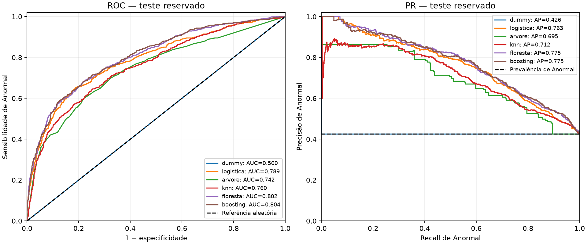
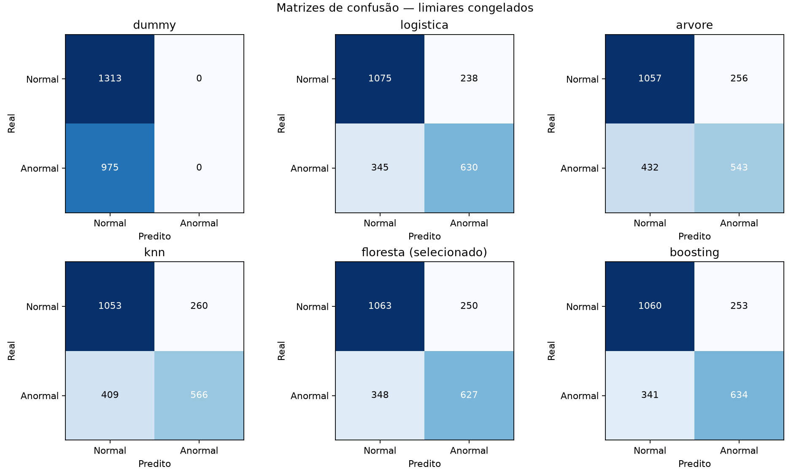
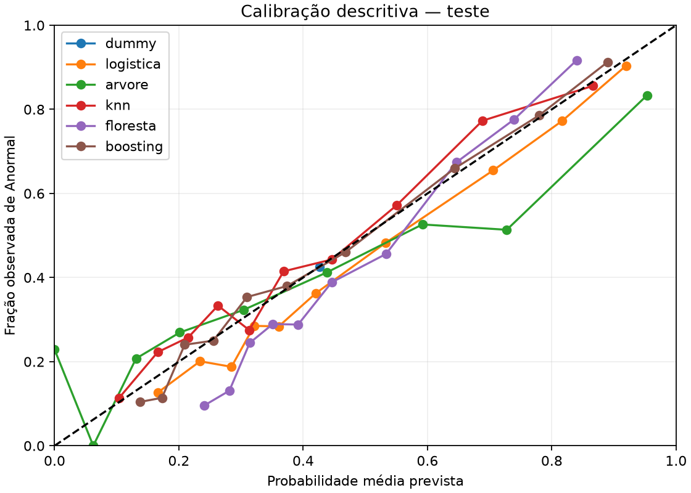

# Experimentos UCMF — resultado técnico

Classe positiva: **Anormal = 1**. Protocolo congelado antes da abertura do teste.
Vencedor escolhido exclusivamente no desenvolvimento: **floresta**, representação **clinica**.
Meta de especificidade média ≥80% no desenvolvimento: **atingida**.
No teste, o vencedor obteve recall **0.6431**, especificidade **0.8096** e AP **0.7748**.
Meta de especificidade no teste: **atingida**.

## População e validade

Foram usados 11436 perfis únicos concordantes na seleção principal. A visão complementar foi vinculada por ID para comparar 12 preditores contínuos/nominais, 9 clínicos e 15 combinados. Os grupos com rótulos conflitantes, repetições e alvos ausentes foram tratados antes desta execução conforme a auditoria. O desempenho é condicionado a essa seleção e não estima automaticamente a população completa de atendimentos. Agrupamento: **registro; independência por paciente desconhecida**. ID de atendimento não prova identidade de paciente. Não foi possível garantir independência por paciente sem ligação individual externa; a incerteza estatística depende dessa hipótese.

A base inteira já foi explorada anteriormente. O teste foi reservado antes dos novos ajustes, não é descrito como amostra historicamente intocada. B2, PULSOS e motivos próximos do diagnóstico continuam por decisão acadêmica. Não há validação clínica, temporal ou externa. Nem um p-valor pequeno transforma essas limitações em ausência de viés.

## Protocolo e seleção

20% para teste, estratificado e aleatório; desenvolvimento com cinco repetições de dois folds externos. Cada metade externa inclui busca interna de três folds, lista pré-especificada de 4 candidatos por família **por representação** e o Pipeline completo. AP média interna escolhe parâmetros e representação; OOF interno da configuração selecionada escolhe maior recall com especificidade ≥80%, depois precisão, especificidade e maior limiar. Essa reutilização interna pode favorecer pontuações internas; somente avaliações externas e teste estimam desempenho. Não houve SMOTE nem exclusão adicional de registros por representação. O Dummy é único, pois ignora os atributos. O orçamento menor restringe a exploração de hiperparâmetros: não se afirma encontrar o ótimo global nem superioridade entre famílias independente do orçamento.

### Comparação das representações no desenvolvimento

A contínua inclui IDADE, Peso, Altura, IMC, FC, PAS/PAD; a clínica substitui idade, antropometria e pressão por FAIXA_ETARIA, CLASSIFICACAO IMC e PPA_CALCULADA, mantendo FC. Ambas conservam SEXO, PULSOS, B2, motivos e HDA. A combinada une esses atributos. PPA/IMC categóricos usam regras clínicas externas, não são supostamente superiores por definição. Quantização perde detalhe e pode ajudar modelos simples; as conclusões aqui dependem da validação. Perfis iguais após reduzir para categorias podem pertencer a pessoas diferentes: não são tratados automaticamente como mesmo indivíduo. Registros idênticos na seleção principal já foram auditados.

| model | representation | recall | specificity | ap |
| --- | --- | --- | --- | --- |
| arvore | clinica | 0.5345 | 0.8338 | 0.6626 |
| arvore | combinada | 0.5450 | 0.8782 | 0.6576 |
| arvore | continua | 0.5450 | 0.8782 | 0.6577 |
| boosting | clinica | 0.6372 | 0.8117 | 0.7592 |
| boosting | combinada | 0.6415 | 0.8046 | 0.7609 |
| boosting | continua | 0.6435 | 0.8030 | 0.7612 |
| dummy | continua | 0.0000 | 1.0000 | 0.4261 |
| floresta | clinica | 0.6439 | 0.8023 | 0.7569 |
| floresta | combinada | 0.6380 | 0.8034 | 0.7507 |
| floresta | continua | 0.6403 | 0.8031 | 0.7546 |
| knn | clinica | 0.4289 | 0.8696 | 0.6257 |
| knn | combinada | 0.5555 | 0.8002 | 0.6759 |
| knn | continua | 0.5713 | 0.8050 | 0.6957 |
| logistica | clinica | 0.6338 | 0.8054 | 0.7496 |
| logistica | combinada | 0.6336 | 0.8038 | 0.7509 |
| logistica | continua | 0.6384 | 0.8027 | 0.7517 |

Essas médias descrevem representações fixas avaliadas externamente, cada uma com tuning interno. A representação do procedimento de cada família é escolhida pela AP interna, nunca por essas pontuações externas; frequências de escolha estão em metricas_externas.csv. O teste usa somente a representação congelada de cada família. Não há novos testes de hipótese escolhidos após inspecionar esta tabela.

O mínimo de 80% é uma regra acadêmica, não meta clínica OMS. Probabilidades são convertidas por p ≥ limiar; a meta não é garantida em novas amostras. A configuração final pode ter um limiar diferente daqueles aprendidos nas metades externas. Os limiares do teste são exclusivamente os congelados no desenvolvimento inteiro. Nenhuma família foi escolhida pelo teste.

### Desenvolvimento: médias das cinco repetições externas

| model | recall | specificity | ap | seconds | folds_below_target |
| --- | --- | --- | --- | --- | --- |
| logistica | 0.6382 | 0.8026 | 0.7505 | 43.7730 | 5 |
| arvore | 0.5345 | 0.8338 | 0.6677 | 24.3692 | 1 |
| knn | 0.5713 | 0.8050 | 0.6947 | 43.1956 | 3 |
| floresta | 0.6439 | 0.8023 | 0.7563 | 113.9017 | 4 |
| boosting | 0.6419 | 0.8067 | 0.7593 | 84.1412 | 4 |

Detalhes dos dez folds e médias/desvios em metricas_externas.csv e resumo_externo_media_dp.csv. Desvios entre folds descrevem variabilidade; dez folds não são dez amostras independentes. As pontuações internas das buscas não são apresentadas como desempenho imparcial.

## Teste reservado — limiar aprendido

| model | accuracy | precision | recall | specificity | f1 | f2 | roc_auc | ap | brier |
| --- | --- | --- | --- | --- | --- | --- | --- | --- | --- |
| dummy | 0.5739 | 0.0000 | 0.0000 | 1.0000 | 0.0000 | 0.0000 | 0.5000 | 0.4261 | 0.2445 |
| logistica | 0.7452 | 0.7258 | 0.6462 | 0.8187 | 0.6837 | 0.6607 | 0.7888 | 0.7629 | 0.1821 |
| arvore | 0.6993 | 0.6796 | 0.5569 | 0.8050 | 0.6122 | 0.5778 | 0.7425 | 0.6948 | 0.2153 |
| knn | 0.7076 | 0.6852 | 0.5805 | 0.8020 | 0.6285 | 0.5988 | 0.7597 | 0.7116 | 0.1936 |
| floresta | 0.7386 | 0.7149 | 0.6431 | 0.8096 | 0.6771 | 0.6563 | 0.8025 | 0.7748 | 0.1823 |
| boosting | 0.7404 | 0.7148 | 0.6503 | 0.8073 | 0.6810 | 0.6622 | 0.8045 | 0.7749 | 0.1747 |

### Teste reservado — referência de limiar 0,5

| model | accuracy | precision | recall | specificity | f1 | f2 | roc_auc | ap | brier |
| --- | --- | --- | --- | --- | --- | --- | --- | --- | --- |
| dummy | 0.5739 | 0.0000 | 0.0000 | 1.0000 | 0.0000 | 0.0000 | 0.5000 | 0.4261 | 0.2445 |
| logistica | 0.7439 | 0.7313 | 0.6308 | 0.8279 | 0.6773 | 0.6486 | 0.7888 | 0.7629 | 0.1821 |
| arvore | 0.6962 | 0.6486 | 0.6267 | 0.7479 | 0.6375 | 0.6309 | 0.7425 | 0.6948 | 0.2153 |
| knn | 0.7159 | 0.7429 | 0.5097 | 0.8690 | 0.6046 | 0.5439 | 0.7597 | 0.7116 | 0.1936 |
| floresta | 0.7382 | 0.7151 | 0.6410 | 0.8104 | 0.6760 | 0.6546 | 0.8025 | 0.7748 | 0.1823 |
| boosting | 0.7513 | 0.7728 | 0.5897 | 0.8713 | 0.6690 | 0.6191 | 0.8045 | 0.7749 | 0.1747 |

Recall mede a fração de anormais detectados; FN representam anormais não sinalizados. Especificidade mede a fração de normais corretamente descartados. Precisão mostra quantos sinalizados realmente são anormais. F1 pondera precisão e recall igualmente; F2 aumenta o peso de recall. Acurácia e ROC-AUC não substituem o objetivo de detecção. AP é average_precision_score, não a área trapezoidal da PR. ROC e PR são complementares; a prevalência é a referência da PR. Brier e calibração descrevem probabilidades, não confirmam utilidade clínica. Nenhuma calibração foi ajustada usando o teste.

## Inferência e incerteza

testes_5x2.json apresenta quatro comparações pré-especificadas contra logística usando erro global no limiar aprendido: F combinado 5×2 principal (10,5 graus de liberdade), t original (5 graus de liberdade) como sensibilidade e Holm separado nas quatro comparações de cada análise. Esses testes são aproximados e não provam superioridade em recall. Variância nula é indefinida, sem p artificial. Não se escolhe o teste mais favorável. Não se aplicam t pareado comum, Friedman ou Nemenyi aos folds como se fossem datasets independentes.

Diferença de erro negativa favorece a família comparada; alfa=0.05. Não rejeitar H0 não prova equivalência.

| model | mean_difference | f_stat | f_p | f_p_holm | rejeita_F_H0 | t_p_holm_sensibilidade |
| --- | --- | --- | --- | --- | --- | --- |
| arvore | 0.0263 | 1.9655 | 0.2360 | 0.6452 | Não | 0.5460 |
| knn | 0.0271 | 220.6118 | 0.0000 | 0.0000 | Sim | 0.0000 |
| floresta | -0.0023 | 1.2016 | 0.4447 | 0.6452 | Não | 0.5460 |
| boosting | -0.0039 | 2.0906 | 0.2151 | 0.6452 | Não | 0.5460 |

mcnemar_teste.json compara vencedor pré-selecionado e logística, condicionando separadamente aos verdadeiros Anormal (detecção) e Normal (especificidade), com duas comparações corrigidas por Holm. A logística não é comparada contra si própria. ICs bootstrap de 95% estão em bootstrap_ic95.csv: 2000 reamostragens estratificadas e pareadas, sem refit ou novo limiar; representam incerteza do teste para modelos fixos, não toda a incerteza do procedimento de treinamento.

| target | n | winner_only_correct | logistic_only_correct | p | p_holm |
| --- | --- | --- | --- | --- | --- |
| 1 | 975 | 41 | 44 | 0.8284 | 0.8284 |
| 0 | 1313 | 41 | 53 | 0.2564 | 0.5129 |

### Intervalos de 95% do vencedor no teste

| metric | estimate | lower | upper |
| --- | --- | --- | --- |
| accuracy | 0.7386 | 0.7212 | 0.7570 |
| recall | 0.6431 | 0.6133 | 0.6749 |
| specificity | 0.8096 | 0.7890 | 0.8302 |
| precision | 0.7149 | 0.6905 | 0.7403 |
| f1 | 0.6771 | 0.6534 | 0.7021 |
| f2 | 0.6563 | 0.6288 | 0.6846 |
| balanced_accuracy | 0.7263 | 0.7080 | 0.7463 |
| roc_auc | 0.8025 | 0.7846 | 0.8209 |
| ap | 0.7748 | 0.7535 | 0.7973 |
| brier | 0.1823 | 0.1760 | 0.1883 |

Os intervalos das diferenças pareadas contra logística estão no mesmo CSV, quando aplicável. Desvios dos folds externos e intervalos bootstrap do teste têm significados diferentes e não são intercambiáveis.

## Interpretação dos atributos

importancia_permutacao.csv contém 20 permutações por atributo original e queda em AP do vencedor. A análise é descritiva e posterior ao congelamento, sem nova seleção ou reajuste. Associações e importâncias não demonstram causalidade; atributos correlacionados podem dividir importância. HDA mede menção; não mencionado não equivale a negado. Imputações não são novas medidas clínicas.

| feature | mean | std |
| --- | --- | --- |
| MOTIVO_UNIFICADO | 0.2034 | 0.0112 |
| B2 | 0.0773 | 0.0070 |
| HDA_UNIFICADA | 0.0213 | 0.0045 |
| FC | 0.0155 | 0.0028 |
| FAIXA_ETARIA | 0.0074 | 0.0016 |
| SEXO | 0.0058 | 0.0014 |
| PPA_CALCULADA | 0.0030 | 0.0016 |
| CLASSIFICACAO IMC | 0.0022 | 0.0011 |
| PULSOS | 0.0006 | 0.0005 |

## Reprodutibilidade e próximos passos

protocolo.json guarda hashes de dados, configuração, código e versões; os candidatos e todas as partições são persistidos. Buscas, avisos, parâmetros, limiares e tempos ficam nos diretórios por modelo. congelamento.json fixa artefatos, seleção e classe positiva. teste_aberto.json impede voltar ao desenvolvimento nesta execução. Retomar o teste lê previsões concluídas em vez de reavaliá-las. O cache só reutiliza operações aprendidas sobre a mesma partição; não ajusta transformações na base inteira.

As evidências apoiam a redação posterior do artigo IEEE e apresentação de avaliacao2.md; esta execução não cria/submete o artigo nem publica no GitHub. O protocolo e fontes completos estão a seguir.

# Protocolo de treinamento e comparação — versão 3 (orçamento reduzido)

Fixado antes da avaliação de teste. Consulta metodológica: 15/11/2026. A versão 2 incorporou três representações e 12 configurações por perfil. Em 15/11/2026, por solicitação do usuário devido ao custo observado, a versão 3 reduz para **quatro configurações por perfil**, mantendo cinco repetições externas de dois folds, três folds internos, os três perfis e todos os demais critérios. A execução válida passa a ser resultado_experimentos_reduzido/. A versão 2 em resultado_experimentos_representacoes/ foi encerrada antes da abertura do teste, com configuração/código arquivados e resultados parciais preservados. A execução ainda anterior está em resultado_experimentos/. Não misturar métricas dessas execuções nem escolher os quatro candidatos por resultados já observados.

## Decisões, fontes e implementação

| Etapa | Decisão | Fonte e limite | Código / evidência |
| --- | --- | --- | --- |
| População | Perfis supervisionados únicos concordantes; seleção anterior preservada | Matriz de preparação e OMS [S1]; não representa automaticamente todos os atendimentos | manifesto_adequacao.json e protocolo.json |
| Identidade e grupos | ID de registro não prova paciente; grupos reais só com mapeamento externo | TRIPOD+AI [S2] e scikit-learn [S3]; independência individual não garantida na base disponível | load_frame, assert_partition, folds |
| Aleatoriedade e estratificação | 20% teste, semente 42; desenvolvimento 5×2 com sementes 101,202,303,404,505 | [S3]; com grupos verdadeiros, grupos prevalecem e estratificação é aproximada | particao_principal.csv e partições externas/internas |
| Validação aninhada | Três folds internos em cada metade; avaliar procedimento completo fora do tuning | [S4]; escores internos são otimistas por seleção | search_and_fit, develop |
| Representação contínua | IDADE, peso, altura, IMC, FC, PAS, PAD + sexo, pulsos, B2, motivo e HDA | [S5–S7]; incluir IMC permite a comparação direta solicitada com seu atributo categórico; redundância não demonstra inutilidade | representacoes_ucmf.py, perfil continua |
| Representação clínica | FC + sexo, pulsos, B2, motivo, HDA, faixa etária, classificação IMC e PPA | OMS [S5], DBHA [S6]; categorias descrevem nutrição/pressão, não o alvo cardíaco | perfil clinica, referências clínicas versionadas |
| Combinada | União dos dois perfis, 15 preditores | [S7]; conveniência preditiva precisa ser avaliada, sem supor superioridade de qualquer representação | perfil combinada |
| Tuning | 4 configurações/família/perfil, 12 por família; mesmas listas nos três perfis; Dummy único | [S4,S8]; orçamento igual entre famílias não garante custo computacional idêntico; redução restringe a exploração | candidatos no protocolo.json; busca.json por perfil |
| Seleção de perfil | Escolher configuração de cada perfil por AP interna, depois perfil pela maior AP interna; empate 1e-6 favorece a ordem continua, clinica, combinada | [S4]; jamais escolher representação pela avaliação externa ou teste | fit_representations |
| Faltantes/codificação | Pipeline ajustado só dentro dos treinos; regras de preparação mantidas | [S9] e referencias/metodologia_preparo.md; mediana é baseline, sem recalcular categoria clínica depois da imputação | preprocessor, oof_interno.csv |
| Limiar | Máximo recall com especificidade interna ≥80%; desempate precisão, especificidade, maior limiar | [S10]; 80% é escolha acadêmica, sem recomendação clínica universal | choose_threshold e threshold_info |
| Métricas | Recall principal operacional, especificidade como restrição; AP para tuning; acurácia, precisão, F1/F2, balanced accuracy, ROC-AUC, Brier e curvas | [S8,S11,S12]; AP não é área trapezoidal PR; ROC é complementar e não inválida por desbalanceamento | metricas_modelagem.py e figuras |
| Inferência no desenvolvimento | F combinado 5×2 sobre diferenças de erro global; t original como sensibilidade, quatro comparações vs logística, Holm em cada família | [S13–S15]; testes aproximados, não prova de melhora em recall; tuning e representação repetidos dentro de cada metade | five_by_two, testes_5x2.json |
| Teste reservado | Seleção por desenvolvimento; pipelines e limiares congelados antes de prever o teste | [S2,S4]; teste já foi explorado em etapas anteriores e só está reservado para estes novos ajustes | congelamento.json, teste_aberto.json |
| Inferência no teste | McNemar exato nos verdadeiros positivos e negativos; duas comparações pareadas vs logística com Holm | [S15–S16]; somente vencedor previamente selecionado, nenhuma comparação consigo mesmo | mcnemar_teste.json |
| Intervalos | 2000 bootstrap estratificados pareados, sem refit; caso haja pacientes, amostragem por grupos inteiros estratificados por composição de classe | [S2,S17]; intervalos de modelos fixos, não toda a incerteza de treinamento; hipótese de independência limitada | bootstrap_ic95.csv |
| Interpretação | 20 permutações por atributo original usado no vencedor; queda em AP, sem nova seleção | [S18]; importância não é causalidade e correlação pode dividir contribuição | importancia_permutacao.csv |
| Relato e código | Configuração, parâmetros, índices, avisos, tempos, pipelines, limiares, versões, hashes e figuras | OMS [S1] e TRIPOD+AI [S2] | relatório técnico e manifesto_resultados.json |

## Escopo científico e orçamento

O resultado principal compara **procedimentos por família**, incluindo escolha interna da representação. As avaliações dos três perfis fixos também são reportadas, mas não originam testes de hipótese adicionais selecionados após olhar os resultados. As cinco famílias são regressão logística, árvore, KNN, Random Forest e HistGradientBoosting. DummyClassifier é referência ingênua e não compete pelo vencedor.

Grades exatas estão em modelos_ucmf.py e permanecem iguais às anteriores. Em todas as cinco famílias, incluindo logística, sorteiam-se quatro configurações sem reposição com sementes fixas; a lista é repetida nos três perfis e nos folds. Não se usam escores antigos para escolher esses candidatos. O protocolo v3 custa aproximadamente **1800 fits internos externos**, contra 5400 no v2, além dos refits e ajustes finais; a OOF do candidato escolhido é reutilizada de sua busca, sem refit redundante. Quatro processos no máximo, um único nível de paralelismo, estimadores internos com uma thread. Cache só reutiliza transformações ajustadas exatamente nos mesmos dados/partição. Não aplica SMOTE. A busca menor é uma comparação condicionada ao orçamento e não demonstra ótimo global dos hiperparâmetros.

Observações que se tornam iguais ao reduzir para categorias não são necessariamente duplicatas ou a mesma pessoa. Não se retiram linhas por perfil: as comparações usam os mesmos IDs e folds. A deduplicação anterior se baseou no contrato principal de 11 preditores; sua seleção e a exclusão de conflitos limitam a população alvo deste estudo.

Um candidato com aviso ConvergenceWarning é inelegível; erros de ajuste interrompem a execução. A busca completa e os avisos são mantidos. Se todos falharem, exige correção documentada e nova execução, sem atribuir score artificial. Não se muda o código de treinamento de uma execução já iniciada e a retoma como se fosse o mesmo protocolo: mudanças exigem um novo diretório.

## Métricas e seleção operacional

Anormal é 1. Recall = TP/(TP+FN), especificidade = TN/(TN+FP), precisão = TP/(TP+FP), acurácia = (TP+TN)/n, F1 = 2TP/(2TP+FP+FN), F2 = 5TP/(5TP+4FN+FP). Balanced accuracy é a média de recall e especificidade. Predição positiva usa p ≥ limiar; o limiar acima do máximo permite prever nenhum positivo, sem forçar um recall mínimo não aprovado.

Selecionar famílias elegíveis com especificidade média ≥80% nas cinco repetições externas, por maior recall médio, depois maior AP, menor tempo total e ordem fixa logística/árvore/KNN/floresta/boosting. Sem elegíveis, registrar meta não atingida e escolher apenas candidato exploratório por AP. O teste não muda essa decisão. Reportar falhas em reproduzir a meta nos folds e no teste. Especificidade abaixo da meta em dados novos não autoriza reajustar o limiar ali.

F combinado: d_ij é erro da família menos erro da logística, s_i² é a soma dos desvios das duas diferenças em relação à média da repetição. F = soma(d_ij²)/(2 soma(s_i²)), referência aproximada F(10,5). t = d_11/sqrt(soma(s_i²)/5), referência t(5) bilateral. Variância zero é resultado indefinido. Não aplicar t pareado comum aos dez resultados, nem Friedman/Nemenyi tratando folds como datasets independentes. Um p não significativo não prova equivalência.

## Referências

- **S1 — OMS (2023).** [Considerações regulatórias sobre IA em saúde](https://www.who.int/publications/i/item/9789240078871): qualidade, documentação, validação e uso pretendido; não certifica este estudo.
- **S2 — Collins et al. (2024).** [TRIPOD+AI](https://www.bmj.com/content/385/bmj-2023-078378), DOI 10.1136/bmj-2023-078378.
- **S3 — scikit-learn.** [Cross-validation e grupos](https://scikit-learn.org/stable/modules/cross_validation.html).
- **S4 — scikit-learn.** [Nested versus non-nested cross-validation](https://scikit-learn.org/stable/auto_examples/model_selection/plot_nested_cross_validation_iris.html).
- **S5 — OMS.** [Padrões infantis](https://www.who.int/news-room/questions-and-answers/item/child-growth-standards) e [IMC por idade 5–19 anos](https://www.who.int/tools/growth-reference-data-for-5to19-years/indicators/bmi-for-age). Fontes e tabelas locais em referencias/README.md.
- **S6 — SBC/SBN/SBH (2025).** [Diretriz Brasileira de Hipertensão Arterial](https://www.scielo.br/j/abc/a/BXT7Vk4B9VKQnJFsJhgJ4Hn/?lang=pt), DOI 10.36660/abc.20250624.
- **S7 — BMJ (2025).** [Continuous variables and non-linear associations in healthcare data](https://www.bmj.com/content/390/bmj-2024-082440.short), DOI 10.1136/bmj-2024-082440.
- **S8 — scikit-learn.** [Métricas](https://scikit-learn.org/stable/modules/model_evaluation.html), [modelos supervisionados](https://scikit-learn.org/stable/supervised_learning.html), [busca de hiperparâmetros](https://scikit-learn.org/stable/modules/grid_search.html).
- **S9 — Sisk et al. (2023).** [Imputation and missing indicators: simulation study](https://pmc.ncbi.nlm.nih.gov/articles/PMC10515473/). Métodos podem comportar-se diferentemente conforme mecanismo de ausência e implantação.
- **S10 — scikit-learn.** [Tuning the decision threshold](https://scikit-learn.org/stable/modules/classification_threshold.html).
- **S11 — Saito e Rehmsmeier (2015).** [Precision-recall plot](https://doi.org/10.1371/journal.pone.0118432).
- **S12 — scikit-learn.** [Calibration](https://scikit-learn.org/stable/modules/calibration.html).
- **S13 — Dietterich (1998).** [Approximate Statistical Tests](https://doi.org/10.1162/089976698300017197).
- **S14 — Alpaydin (1999).** [Combined 5×2cv F test](https://pubmed.ncbi.nlm.nih.gov/10578036/), DOI 10.1162/089976699300016007.
- **S15 — Holm (1979).** [Sequentially rejective multiple test procedure](https://www.ime.usp.br/~abe/lista/pdf4R8xPVzCnX.pdf).
- **S16 — McNemar (1947).** [Correlated proportions](https://doi.org/10.1007/BF02295996).
- **S17 — Efthimiou et al. (2024).** [Developing clinical prediction models](https://www.bmj.com/content/386/bmj-2023-078276). Relatar validação, incerteza e limitação populacional.
- **S18 — scikit-learn.** [Permutation feature importance](https://scikit-learn.org/stable/modules/permutation_importance.html).

O resultado técnico apoiará o artigo IEEE e a apresentação exigidos em avaliacao2.md após os experimentos. Nenhum resultado de validação interna será descrito como validação clínica externa. Não há publicação ou submissão automática.
